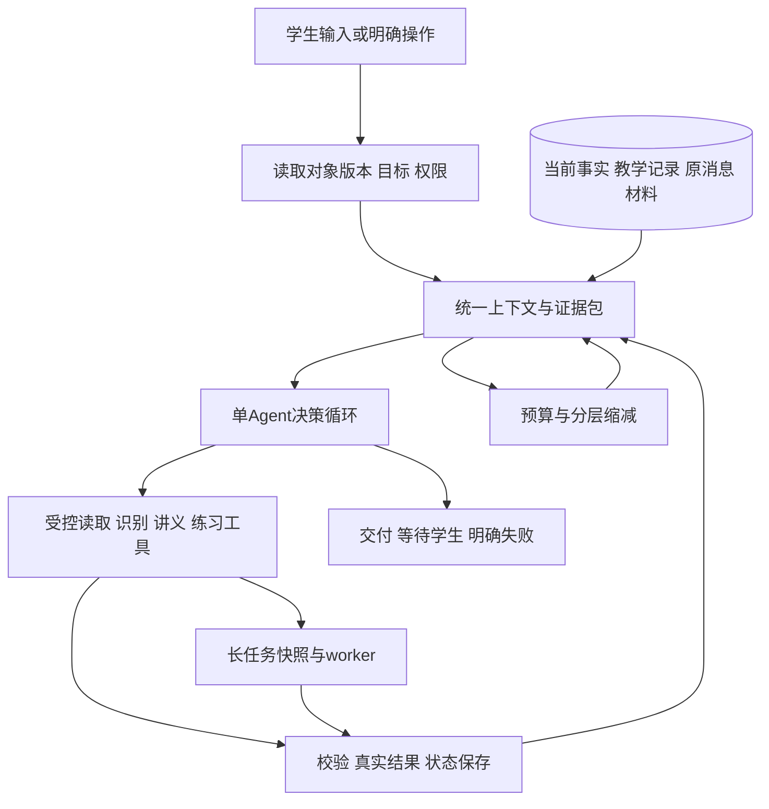

# Historical Reviews

归档日期：2026-11-06。**以下为各次评审发生时的快照，仅供追溯，不作为当前缺口、下一步顺序或现行设计。** 其中的“当前”“下一步”“未实现”只指原评审时点；后续修复与需求变更不回写历史结论。

当前状态只看 [progress](../delivery/progress.md)，任务只看 [plan](../delivery/plan.md)，设计只看 [design](../README.md#design)。评审发现对应的未完成任务已归入现行计划，历史文件不参与日常续作上下文。

- [服务端接入评审：2026-11-05](#backend-review)
- [B04-R开工评审：2026-11-06](#project-review)
- [Agent课程与代码评审：2026-11-06](#agent-capability-review)

## Luma 服务端接入方案评审

日期：2026-11-05。代码基线：`a52b52b`。依据：[PRD](../spec/PRD.md)、[交互设计](../design/interaction.md)、[Agent 设计](../design/agent.md)、[数据接口设计](../design/data-api.md)。

**职责：记录本次开工前代码差距、技术判断和整改顺序。** 这是静态评审结论，不是接口、真实 GPT 或真机测试通过记录。后续任务维护在 [实施计划](../delivery/plan.md)，已完成状态维护在 [进度](../delivery/progress.md)。本次未修改业务代码、未调用真实 GPT。

### 1 评审结论

现有 uni-app / Vue 3、Next.js / TypeScript、Prisma / PostgreSQL、AI SDK 和单 worker 适合当前个人学习助手竞赛版，可以沿用。自有单层 Agent 循环、原生工具协议、数据库状态和有限恢复是合适的实现方向，不需要改框架或建设通用 Agent 平台。

当前不能只关闭 UI mock 就认为正式功能可用：已验收交互与正式服务的数据归属、返回结构、页面适配及生成能力尚未对齐。先完成 B01 数据契约，再按文字教学、图片、图文与练习逐段联通；真实 GPT 连通探针可在不改变数据契约的前提下提前验证。

**开发联调使用微信开发者工具连接本地 API、PostgreSQL 和 worker。真实微信登录、手机预览、线上 HTTPS 与体验版发布不作为当前开发的启动条件。** 开发身份仍建立应用登录态并验证本人归属；真实登录和设备行为在对应阶段验证。

### 2 发现与整改

P1 表示正式接入相关链路前必须修正；P2 表示随相应模块补齐。排序按当前开发依赖，而非要求一次性修完所有模块。

| 编号 | 级别 | 代码证据 | 影响与处理结论 | 任务 |
| --- | --- | --- | --- | --- |
| F01 | P1 | [schema.prisma](../../apps/server/prisma/schema.prisma) `SubjectRevision` 会话级版本唯一、`LearningProgress` 每会话一条；[policy.ts](../../apps/server/src/agent/policy.ts) / [subject.service.ts](../../apps/server/src/services/subject.service.ts) 按会话取最新题；[jobs/shared.ts](../../apps/server/src/jobs/shared.ts) 同样按会话最新版本发布 | 多题切换后可能改错对象或将另一题的任务判为失效。引入稳定 `subjectId`、对象内版本、对象进度和会话焦点；Agent、工具、消息、发布统一引用对象版本。不能只改表不改查询和发布检查。 | B01 |
| F02 | P1 | [practice.ts](../../apps/miniapp/src/api/practice.ts) 声明顶层 `answers[]`；[practice.service.ts](../../apps/server/src/services/practice.service.ts) 实际返回 `exercises[].myAnswer`；[practice page](../../apps/miniapp/src/pages/practice/index.vue) 正式入口未接入，主交互使用 preview store | 现有类型不能正确描述服务结果；关闭 mock 不能恢复已验收练习体验。统一共享响应 schema、练习状态 store 与页面适配；同一展示结构接 mock/正式数据，保留原页面布局。 | B01、B05 |
| F03 | P1 | [collection.service.ts](../../apps/server/src/services/collection.service.ts) `remove` 执行 `deleteMany`，笔记和复习状态在该行；[conversation.service.ts](../../apps/server/src/services/conversation.service.ts) `update` 总是写 `lastActiveAt` | 取消收藏会连笔记记录一起删除，重新收藏不能按交互恢复；重命名/归档改变最近学习排序。收藏改为对象级软取消并过滤列表，保留笔记；管理操作不更新学习时间。 | B01、B06 |
| F04 | P1 | [practice.service.ts](../../apps/server/src/services/practice.service.ts) `start` 每次创建轮次；[start route](../../apps/server/src/app/api/practice-attempts/route.ts) 无操作去重标识；缺少按题组列历史和仅更新位置的明确接口 | 刷新、重复点击或返回若重调 start 会另开一轮；跳到空题不保存答案时也无法可靠恢复题号。读取/继续与明确开始/重做分开，创建请求幂等，补轮次列表和位置更新；提交前等待本轮草稿保存完成。 | B01、B05 |
| F05 | P1 | [run.service.ts](../../apps/server/src/services/run.service.ts) 目标仅由 `generate_lesson/practice` 按钮建立；`retryOfRunId` 仅赋值，仍新建用户消息；[conversation store](../../apps/miniapp/src/stores/conversation.ts) 发送不带材料、段落、轮次及题目引用 | 自由输入“讲解后出题”没有持久化完整组合目标，显式重试会重复用户消息，真实局部追问可能丢焦点。首个必要决策结构化保存请求目标，程序验证范围；显式重试加载本人原运行和用户消息；发送时携带经校验的焦点与返回目标。 | B02 |
| F06 | P1 | [context.ts](../../apps/server/src/agent/context.ts) 把题干拼入 system；[run.service.ts](../../apps/server/src/services/run.service.ts) 仅取12条、每条按字符截断；[loop.ts](../../apps/server/src/agent/loop.ts) 决策直接使用累计协议；[model.ts](../../apps/server/src/lib/model.ts) 无输入预算装配 | 与既定可信规则/材料分层、关键条件完整保留及 token 预算设计有差距。材料降为数据消息，每次决策按预算装配，工具调用结果成对保留；只裁剪非关键内容，关键事实超限则澄清，不需要先做自动摘要或 RAG。 | B02 |
| F07 | P1 | [model.ts](../../apps/server/src/lib/model.ts) 收完整工具调用后才取 `respond.text`；[loop.ts](../../apps/server/src/agent/loop.ts) 一次发送全部 `text.delta`；[policy.ts](../../apps/server/src/agent/policy.ts) 仅显式 action 授权解析；[tool-executor.ts](../../apps/server/src/agent/tool-executor.ts) 练习读取未提供作答照片或按权限返回当前题解析 | SSE 已有但正文非渐进显示；自由输入主动索要解析、带照片的本题追问仍不完整。保留 respond 协议，增量提取唯一 respond 调用的文本并标未完成，混用/失败不得提交成功；语义请求经程序核验当前焦点后只授权本题，记录帮助使用，正常提示不下发答案。 | B02、B03、B05 |
| F08 | P1 | [upload.service.ts](../../apps/server/src/services/upload.service.ts) / [cos.ts](../../apps/server/src/storage/cos.ts) 未实现；[protocol.ts](../../apps/server/src/agent/protocol.ts) 使用 `attachment:` 占位图片；[tool-executor.ts](../../apps/server/src/agent/tool-executor.ts) 识别固定返回不可用；[subject.service.ts](../../apps/server/src/services/subject.service.ts) 过程确认只读取未保存确认步骤 | 本机图片预览不等于真实视觉输入。实现受限上传和私有读取，调用前将本人附件转换为模型支持的图片输入；识别结构化保存多题/不确定条件，过程确认实际更新步骤和版本。3张、8 MB 在接口和工具层一并校验，现有 TurnRequest 的 max(4) 需对齐。 | B03 |
| F09 | P1 | [lesson.task.ts](../../apps/server/src/jobs/lesson.task.ts) 只有正文和文本描述复核，无图片生成；[practice.task.ts](../../apps/server/src/jobs/practice.task.ts) 与讲义未实现一次质量修复；[StudyText.vue](../../apps/miniapp/src/components/StudyText.vue) 仅轻量段落/粗体 | 真实图文主能力缺失，模型返回的 LaTeX 无法完整显示。先固定讲义/题组 schema，再接 GPT 配图、实际图片输入复核、有限修复和公式渲染；生成图映射到章节附件，公式工具仅负责显示。 | B04 |
| F10 | P2 | [model.ts](../../apps/server/src/lib/model.ts) `generateJson` 未返回 usage，purpose 未进入记录；[lesson.task.ts](../../apps/server/src/jobs/lesson.task.ts) / [practice.task.ts](../../apps/server/src/jobs/practice.task.ts) 未统一登记实际请求和修复消耗 | 主循环有次数保护，但不足以说明后台生成的全部消耗已受控。所有模型调用经统一适配记录用途/用量/耗时，任务和父运行累计预算不随恢复重置，未知用量保留未知；保留单 worker，不加费用结算平台。 | B02、B04 |

### 3 R01～R05 评审决定

#### R01 数据和迁移

采用 `Conversation → LearningSubject → SubjectRevision → Artifact / PracticeAttempt`。稳定对象 ID 与版本 ID 分离；消息、过程、任务、收藏及进度必须可定位对象。会话保留整段标题/归档和当前焦点，收藏唯一约束为用户与对象。

迁移已有记录时，每个旧会话建立一个首对象，将该会话原版本、材料、消息及收藏关联过去，不清空数据库、不改写历史作答。发布检查比较来源对象的当前版本，而不是整段对话中版本号最大的题。

#### R02 页面与正式数据

继续复用已验收页面；API/store 负责数据转换，不再制作第二套正式版页面。共享 schema 至少定义会话详情、对象摘要、讲义、轮次/草稿、自评反馈、收藏详情和续学位置，前端与服务端采用同一结构。

恢复顺序为：校验登录及归属 → 读取会话/对象 → 读取固定材料与轮次 → 对齐尚未同步的本人草稿 → 定位原章节/题号。切页只恢复，不能调用生成、提交或重做。保存失败保留本机输入并可重试，提交前等待待保存请求完成；草稿冲突不得静默覆盖。

#### R03 Agent

保留唯一驱动器、原生工具调用、四项业务工具和 respond 终止协议。不增加意图分类 Agent 或第二层 SDK 自动循环。自由输入目标经当前 Agent 的结构化决策保存；后台登记后进入 waiting_job，工具结果按调用 ID 回到同一驱动器。

短工具结果校验后继续决策；需要学生时停止；组合目标必须检查各成果实际存在。采用一个统一模型适配层支持文本、结构化输出、视觉及图片生成的各自能力，配置留在服务端，具体模型可用性在真实连通阶段实测，不在此更换模型。

渐进正文仍需在开发者工具测首段、停止、终态与重新拉取；协议无法可靠增量解析时保留明确的整段降级，但不能把降级当成流式要求完成。

#### R04 教学成果

讲义先生成结构化正文及配图要求，实际配图由 GPT 图片能力生成并保存附件，再将图片及相关正文交给视觉复核。先显示正文草稿和阶段状态，复核通过才发布；图片失败可以继续对话和重试。局部换例子创建新讲义版本，保留原版本及其章节上下文。

题组默认两题，schema 完整校验 → 独立复核 → 至多一轮修复再复核 → 发布。答案分阶段投影；当前题主动看解析单独授权，不将其他题答案送到作答端。数学正确性用真实样例评估，不能由结构校验或一次复核保证。

#### R05 开发与交付

开发阶段只需本机微信开发者工具、小程序编译、本地 API、PostgreSQL、worker，以及到真实 GPT/COS 的服务端访问。使用文件选择器准备题目图片，不必先打开手机相机；开发身份不影响教学及数据库联调。

真实微信换码可在已配置 AppID/AppSecret 后直接于工具验证，失败不阻塞其他模块；开发者工具无法完全覆盖的相机、键盘、手势和设备差异安排到后期。HTTPS 线上部署、成员配置和上传体验版在交付阶段处理，不进入 B01～B06 的前置依赖。

### 4 页面动作与服务契约映射

以下为评审确定的目标契约，尚未新增到业务代码。路径统一加 `/api`；既有单对象接口在迁移期间更新调用方，不做长期双协议兼容。

| 页面动作 | 请求/事件 | 持久化与恢复规则 |
| --- | --- | --- |
| 新建提问/追问 | `POST /conversations`；`POST /conversations/:id/turns`，携带 requestId、subjectId、expectedRevision 及可选 focus | 首条建立对象，后续不重复建；图片首发可暂未有对象，识别完成批量建立待确认对象 |
| 多题切换 | `PUT /conversations/:id/focus` `{subjectId}` | 恢复对应对象进度；生成/识别中沿用现有暂禁切换交互 |
| 单题编辑/核对 | `POST /conversations/:id/subjects/:subjectId/revisions`；`POST /conversations/:id/subjects/:subjectId/confirm` | 显式版本检查，只修改该对象；改题干使该对象旧任务失效 |
| 生成及打开讲义/题组 | turns 明确 action 或自由输入；`job.created/run.waiting`；`GET /jobs/:id`、`GET /artifacts/:id` | 固定对象版本及任务输入；读取不重复生成，查询不发模型请求 |
| 阅读章节/作答位置 | `PUT /conversations/:id/subjects/:subjectId/progress` | 版本化保存目的地、artifactId、sectionId、attemptId、exerciseId；读取会话详情恢复，失效则回原对话 |
| 段落或本题追问 | turns 携带对象、artifactId/sectionId 或 attemptId/exerciseId | 校验完整关联；返回目标由业务状态保存；结束追问清除焦点不删草稿 |
| 开始/继续/重做 | 新开用 `POST /practice-attempts` 加 requestId 和可选 redoOfAttemptId；继续用 `GET /practice-attempts/:id` | 初次开始/明确重做才新建；重复请求返回同一轮次，不用 start 作为页面加载 |
| 历史轮次 | `GET /artifacts/:id/attempts`；打开指定 attempt | 按题组列本人轮次，已完成轮次只读；不替换当前练习轮次 |
| 草稿/提交/自评 | 复用 answers、submit、complete 接口并共享响应 schema | 保存按题递增版本，提交前刷完草稿；阶段操作可安全重试；历史不得修改 |
| 收藏/笔记/复习 | `GET /collections` 支持 view/keyword/reviewStatus；`GET /collections/:subjectId`；`PUT/DELETE /collections/:subjectId` | 用户与对象唯一；DELETE 仅取消收藏，笔记仍保留；GET 详情校验本人归属 |
| 上传/过程 | 复用 uploads/create/complete；过程识别结果确认接口 | 本人附件、完成校验、3张/8 MB；转写确认持久化后才纠错 |
| 归档/恢复/改名 | 复用 `PUT /conversations/:id` | 管理操作不更新学习时间；发新消息在服务端恢复归档并更新，避免依赖客户端两次请求 |

`subject.updated`、`artifact.updated` 等对象相关事件补 subjectId 和来源版本；纯运行状态事件按 runId 解析归属，前端只应用到对应对象。所有路径在 B01 中落共享 schema 和迁移，不在本次评审提前生成占位路由。

### 5 实施与验证决定

第一项为 B01：数据归属、共享契约和正式前端适配基础。B02 接一题文字教学及真实 GPT，同时验证连续三轮、停止、重试和重进；每一步都在微信开发者工具实际操作并核对数据库。B03 图片、B04 图文、B05 练习按小闭环扩展，B06 记录随相应链路接入；纯文字讲解不必等拍题识别全部完成，直接练习也不必先生成讲义。B07 才进行真实身份、真机及体验版交付。

评审保留的技术边界：单服务实例、单 worker、数据库任务队列；不做 RAG、多 Agent、自动摘要、长期画像、自建 KV cache、通用工作流或精细费用系统。个人学习记录用于接续学习，不建设统计分析面板。

本次不运行业务回归：没有实现改动。后续验证需覆盖本表列出的实际差距，不能把原47项用例通过等同于新增契约与真实模型已通过。

### 6 参考核对限制

OpenAI Docs 技能尝试读取官方 function calling 文档；当前网络分别返回 Forbidden 与访问拦截页，未取得可核验正文。本次协议判断依据仓库中已安装 AI SDK 的调用方式和项目代码，不声称已完成最新官方兼容性核对；真实接入时验证实际工具调用及结果配对。未据此变更框架、模型或实现参数。

---

## Luma 项目方案与开发就绪评审

评审日期：2026-11-06。本文为 B04-R 开工前评审基线；后续已实现内容以 [进度](../delivery/progress.md) 和 [验证记录](../delivery/verification.md) 为准，不把本节历史发现当作当前仍未处理。范围：现行 PRD、验收规格、交互、系统/Agent/数据设计、实施计划及对应实现。不是完整生产安全审计，也不替代真实教学或真机验收。

### 1 结论

**产品范围和架构方向明确，可以继续开发；尚不能宣称所有设计和业务链路均已闭合。** 当前应收口已有图文教学链路，同时补最小教学上下文；随后按模块接上传、练习及学习记录。不重做 UI，不换技术栈，不先建设完整 Agent 平台。

已经明确的边界：个人学习助手；首期仅交付高中数学；uni-app 微信小程序 + Next.js/TypeScript + PostgreSQL + 单 worker；服务端统一 GPT；单 Agent 驱动、受控工具、异步任务。公共运行时保持通用，数学作为当前唯一内容规则，不开发其他学科。COS 保存图片，GPT 做视觉理解，不另建传统 OCR 流程。

教学正文与图示方案由主 GPT 产生，受控渲染并复核；学生确认理解后主动生成的静态总结图解卡是独立成果，不能与教学配图混为一项。教材 RAG、视频、多 Agent、自建 KV cache 和长期画像均不进入本期。

### 2 主要发现与处理

| 优先级 | 发现及影响 | 决定与后续任务 |
| --- | --- | --- |
| 当前必须收口 | 公共提示词仍是高一数学角色，统一引导限制会压制概念解释；与通用运行时目标不一致 | AG01：公共身份通用化，数学规则集中配置，解题/概念/纠错分策略；不引入多学科路由 |
| 当前必须收口 | 近期消息截取不等于教学记忆；旧消息工具读取范围还需收紧，材料局部重讲缺原文快照 | AG02 + B04-R：带证据教学进展、限定回读、固定局部修订输入；契约见 data-api §5 |
| 当前必须收口 | 函数图真实展示已通过，但正式段落追问发送/返回和阅读进度服务端恢复未验；图示只支持有限函数/几何数据 | B04-R：先点通现有阅读闭环；扩充数学需要的受控关系/过程表达，不强套函数图 |
| 下个模块开工前补齐 | 上传及 COS 服务仍是未实现，recognizeMaterial 返回不可用 | B03：按 data-api §6 固定附件归属、完成校验、识别快照和确认状态，再接 GPT 视觉 |
| 下个模块开工前补齐 | 练习正式页不可用，开始/重做尚无完整幂等；错题本仍为 mock | B05/B06：正式状态与持久化接线；开始/续做/重做严格分开，不以页面存在算完成 |
| 已有需求不能遗漏 | 总结图解卡缺成果类型、确认引用、去重、重试和读取契约 | B04-S：目标见 data-api §7；新增 AC-22。保留 P0，不作为讲义的生成依赖 |
| 随各闭环修补 | 成功但无进展、输出截断、流式静默超时等保护未完整；历史进度描述落后于代码 | AG04/AG05 随调用路径实施；文档已统一现状，约12个行为场景与约20道数学内容样例分别验证 |

证据入口：`apps/server/src/agent/prompts/system.md`、`services/run.service.ts`、`agent/tool-executor.ts`、`services/upload.service.ts`、`storage/cos.ts`、`jobs/lesson.task.ts`、`apps/miniapp/src/pages/reader/index.vue`、`pages/practice/index.vue`、`pages/notebook/index.vue`、`packages/shared/src/content.ts`。Agent 详细分析见 [能力评审](#agent-capability-review)，早期服务接入差距见 [服务端评审](#backend-review)。旧评审保留其基线，不当作当前完成状态。

### 3 下一批实施：B04-R（含最小 AG01/AG02）

1. 公共身份与数学内容规则分开，修正概念解释和解题提示的权限区别。
2. 按对象版本保存最小教学进展，按明确引用回读材料与旧消息；不每轮额外调用模型写摘要。
3. 正式阅读页携带对象/材料版本/段落追问，返回原段落；阅读位置同步服务端。
4. 换例子/局部重讲固定原材料及权限快照；发布新版本，未修改段落保持一致，旧版本可读。
5. 在微信开发者工具连接本地真实服务验证：阅读→追问→返回→换例子→重进恢复；检查跨对象/修订隔离、图示放大、停止/重试和旧任务返回。

完成条件：代码与必要的确定性回归通过；真实 GPT 的上述路径留下证据；未完成的总结图卡/上传/练习不冒充完成。运行时修补仅覆盖本批触及的路径。变更经用户确认后再提交推送。

后续顺序见 [实施计划](../delivery/plan.md#1-执行顺序)。本次不启动业务代码修改。

### 4 本轮验证及限制

当前工作区 `pnpm typecheck` 通过，`pnpm test` 62/62 通过。本轮还做文档一致性检查；未重新点击 UI、调用真实模型、验证数据库迁移或部署。此前文字教学及函数图真实证据见 [验证记录](../delivery/verification.md)。这些检查不等于完整产品交付通过。

---

## Agent 能力评审与实施取舍

评审日期：2026-11-06。范围：当前feature工作区，包含B04-R及滚动摘要/缓存未提交变更。本轮为课程、代码和现行设计的联合复核；不把目标设计写成已实现，不以现有测试数代表完整Agent质量。

依据：[课程全文](../../../agent课程笔记/01-课程全文-吃透AI-Agent开发.md) 第6～9、14～18、23～24、27～28篇及 [能力清单](../../../agent课程笔记/02-生产级Agent能力清单.md)。本轮重读上下文、压缩、JIT和记忆失效原文，逐项检查执行循环、模型适配、工具读取、教学状态、摘要和后台输入；课程里的厂商实现及性能数字未另行外部核验，不直接当项目参数。

**职责：说明架构判断、课程取舍与代码差距。** 最终机制在 [Agent设计](../design/agent.md)，字段在 [数据设计](../design/data-api.md)，施工顺序在 [计划](../delivery/plan.md)，实际状态在 [进度](../delivery/progress.md)，验证结果在 [验证记录](../delivery/verification.md)。

### 1 结论

既有“单Agent + 受控工具 + PostgreSQL/worker”的方向适合竞赛版，不需要换框架或重写。但此前把摘要、回读、事实更正分开推进，未形成信息进入、使用、更新、卸载、找回的闭环。课程已明确“先卸载、可恢复紧凑化、最后摘要；检索贯穿始终”，先做摘要再补检索的顺序不充分。此问题来自设计与实施评审，不应由用户逐条发现。

最佳实现取决于产品范围：首期功能集中高中数学，教学连续性、来源隔离、可恢复执行和验证质量不因此省略；多学科内容、长期画像及生产平台可以后置。预留采用职责清楚的协议与版本，不以空接口或未来承诺代替首期闭环。

### 2 首期统一结构

- 理解学生、决定讲法、选工具与解释结果由GPT负责；账号/来源/版本/权限、真实执行、幂等、取消、资源与发布由工程保证。
- 当前题干、任务状态和有效证据优先；摘要只表示较早过程，不能覆盖正式事实或给自己增加权限。
- 自由输入允许Agent选择路径；明确单步操作可直接调用受控执行器。草稿、自评、归档等不需增加模型调用。
- 后台生成是单Agent调用的能力，不另设多Agent；停靠等待不轮询模型，恢复共享原任务预算。

### 3 课程与代码对照

| 能力 | 代码证据与当前判断 | 首期处理 |
| --- | --- | --- |
| 单层循环与目标 | agent/loop.ts、types.ts、protocol.ts：计划、执行、观察、显式respond，组合成果等待恢复已有 | 沿用；检索回读要求也纳入完成条件，不能已排队就宣称完成 |
| 工具、权限、状态 | tools.ts、tool-executor.ts、run-guard.ts：schema、归属、版本、活动运行、幂等边界已有 | 新记忆/检索复用同一边界；大输出需可恢复引用，错误可指导纠正 |
| 信息入口与JIT | context.ts、tool-executor.ts：当前材料、段落、作答与ID/游标读取已有 | 增加历史原文搜索；确定来源预加载，不给模型重复读全库 |
| 记忆生命周期 | teaching-state.ts：最多12条、同kind/focus覆盖、全局slice(-12) | 需来源条目及新增/解决/替代/冲突状态，去除存储层静默挤掉有效卡点；保留近期原文作为提取失败的缓冲 |
| 摘要保真 | compaction.ts：80%触发、逐字引用、检查点保存后替换、原文保留已有 | 能证明引用存在，不能证明提取完整；加入有效记录及覆盖校验，不把旧关键引用无期限只增不减 |
| 连续追问发现历史 | history.ts严格焦点隔离；工具已支持messageIds，但无关键词定位 | 区分对象通用要求与局部记录；不放松答案权限。历史指代/条件冲突要求取证，不能等待模型碰巧想起ID |
| 工具输出缩减 | protocol完整保存，本轮所有结果仍占输入；无已完成结果的可恢复紧凑化 | 优先减大只读结果；保留配对、错误、写入凭证及最近完整轮次；不是先丢学生历史 |
| 缓存与预算 | model.ts/limits.ts：真实缓存用量、累计账与上限已有；context.ts的system仍含动态程序状态 | 稳定公共前缀；发送前预留本次输入/输出；unknown不视为免费。300k/1m配置不当容量证明 |
| 成功无进展 | loop.ts仅同失败hash连续两次检测，参数JSON未稳定排序，成功会清空计数 | 稳定参数+实质结果指纹；先提醒换策略再停止，后台状态变化不误判；共享次数/时间/消耗保险丝 |
| 模型异常与断流 | model.ts关闭隐式重试、有超时及部分文本；未显式检查finishReason。sse.ts无心跳，小程序无静默看门狗 | 分类有限重试；截断参数不执行、材料不发布；心跳/看门狗后查DB，不重新盲发 |
| 教学内容与快照 | lesson.task.ts已有目标、进展、来源快照、复核/修复；局部修订保留未改章节 | 统一证据包，练习/图卡随接入对齐；扩充实际需要的数学图示，不强套三段/函数模板 |
| 评测与观测 | Run/Tool/Job及用量日志，77项测试与真实摘要/局部修订已有证据 | 新增遗忘、纠错、回读、失败与恢复的固定场景；真实GPT检查语义，确定性检查工程不变量 |

代码已有能力不重做；上表差距只归入现有AG02～05/B模块，不新增“Agent平台阶段”。本次未重新运行真实模型，不把静态代码复核当作质量验证。

### 4 采用与暂缓

| 课程方向 | 首期采用的最小实现 | 预留或暂缓 |
| --- | --- | --- |
| Offload/Retrieve/Reduce | 现有DB存原文/成果，按引用+原文搜索，旧结果紧凑化，80%必要摘要 | 需要指定教材引用时再建教材入库与向量召回，不为聊天回读建全科RAG |
| Memory | 当前对象内来源条目、状态、更正及按需召回；同一会话可持续学习 | 跨会话自动偏好、能力画像、衰减/自动梦境等治理平台后置 |
| Loop/Harness | 单循环、真结果、边界/预算、有限重试、等待恢复、无进展及断流保护 | 不照搬课程10/20/30次数，不做通用工作流或任意指令位置续跑 |
| Cache | 实际缓存用量、稳定前缀、已存在确定性渲染缓存 | 不自建KV cache；计算缓存等待真正的计算工具和版本化输入 |
| 通用能力 | 任务/来源/工具/内容协议不绑定年级，数学规则当前唯一配置 | 新学科按规则+必要工具+样例增量加入；不预建学科管理、路由或插件市场 |
| 评测 | 约12类Agent行为场景与约20道数学内容样例，复用现有测试及日志 | 无需先上第三方观测平台、自动评测平台、模型路由或多供应商容灾 |

课程不是实现清单全选。没有外部工具接入、多上下文隔离收益或吞吐证据时，不加入MCP、Swarm、Redis或第二套编排框架。未知模型容量、不支持的图示和未验证结果明确暴露，不能用“大窗口/通用Agent”隐藏限制。

### 5 收口顺序与评审规则

当前先完成AG02的信息闭环及已有教学路径上的AG04可靠性门槛，保留当前阅读UI、真实GPT和旧数据。具体可提交任务见plan中的AG02.1～AG02.4、AG04；每项均有本地可验证结果。随后继续B03上传视觉、B05练习、B06记录和B04-S总结卡，可靠性与质量验收随路径接入，不等全部代码写完再联调。

后续一个任务同时交付：目标及依赖、代码、异常与来源保护、确定性测试、必要真实教学样例、进度/验证更新。测试数不是质量结论；发现已列明但未实施的项目不重复称为新发现，也不把每个失败都升级为新模块。

设计变更只在出现实际代码冲突、已记录场景失败或新产品要求时调整，写明证据及影响。PRD、已验收UI及首期范围不因本轮内部机制修订而变化。当前只更新设计与任务，不修改运行代码、不提交推送。
