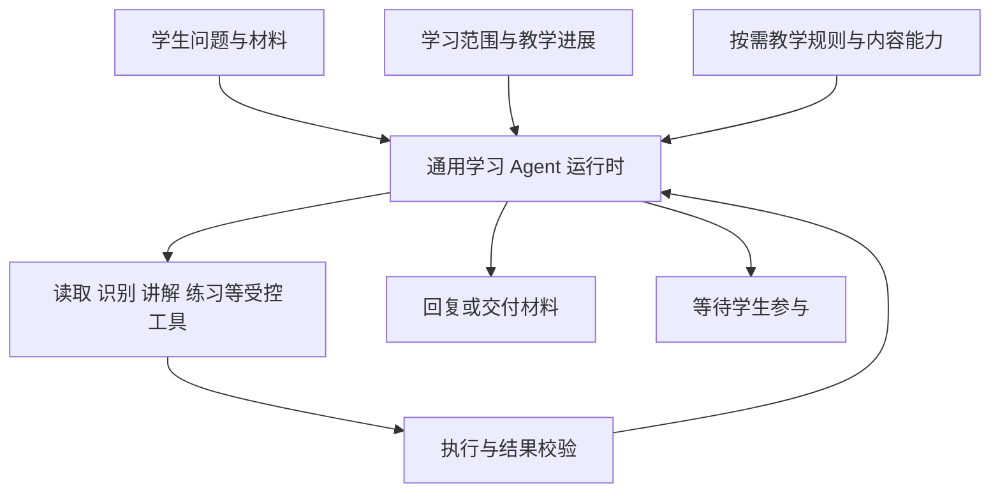

# Agent 能力评审与补齐建议

评审日期：2026-11-06。范围：当前工作区代码，包含尚未提交的 B02/B04 变更。本文是静态评审与规划，不代表新增能力已实现或已验收。

依据：新增的 [能力清单](../../../agent课程笔记/02-生产级Agent能力清单.md)，及 [课程全文](../../../agent课程笔记/01-课程全文-吃透AI-Agent开发.md) 中循环保护、上下文、检索、记忆与 Harness 等相关章节。运行机制以 [Agent 设计](agent.md) 为准；任务和实施状态分别在 [计划](../delivery/plan.md)、[进度](../delivery/progress.md) 维护。

## 1 结论与范围

Luma 的目标是个人通用学习 Agent。首期以高中数学内容集中验证教学质量与竞赛演示闭环，不把运行时、工具协议或学习对象限定为高一数学。

目前已具备真实 Agent 的执行骨架：模型选择工具，程序校验并执行，结果回传后继续决策，长任务落库等待并恢复。下一阶段重点是教学连续性、内容表达适配和运行可靠性，不是再搭一套编排框架。

应区分三件事：

| 层面 | 当前目标 | 不应混同 |
| --- | --- | --- |
| 产品定位 | 个人通用学习助手，围绕学生的问题、材料与练习提供帮助 | 不能将角色永久写死为某个年级的学科老师 |
| 技术适用性 | 同一循环、权限、上下文和材料协议能处理不同学习内容 | 不需要按学科重写 Agent 或建立多个老师 Agent |
| 首期质量承诺 | 仅交付、验收高中数学；检查公共运行时不依赖特定年级或数学题型 | 预留扩展位置不等于本期开发或验收其他学科 |

保留已确认的图文教学、同类练习、错题与笔记需求。不因通用化扩展班级、教师、后台分析、全学科题库或新菜单。

用户确认边界：首期单学科实现，能力预留不能封死。数学规则可以作为当前唯一内容配置，公共身份与运行时保持通用；其他学科的教学规则、专用工具、题库和验收均不属于本期任务。预留以清晰的上下文、工具和内容协议为限，不预建多学科平台。

## 2 对课程建议的取舍

课程最值得采用的是：模型负责理解与选择，工程负责权限和状态；信息按需进入上下文；记忆有来源；执行必须有停止条件；生成结果要独立验收。

清单中的 Luma 对照表已滞后于当前工作区，不能直接照搬为待办：

| 清单判断 | 当前代码核对 |
| --- | --- |
| `recordFailure` 未接线 | `loop.ts:169` 已接入；但只识别连续相同失败，成功无进展仍是缺口 |
| 没有累计 token 预算 | `limits.ts` 已有累计请求/用量检查，`model-accounting.ts` 已聚合后台请求；并非精确费用预留或下一次请求的完整预算预留 |
| 题干进入 system | `context.ts:29` 已将题干作为学习数据消息；system 仍拼接动态程序状态，前缀稳定性还可优化 |
| 上下文只有 12 条截断 | 最近 12 条筛选仍存在；另已有当前事实装配、输入预算及整轮旧历史淘汰。尚无教学进展摘要、旧轮次按需回读 |
| 47 项回归 | 上轮记录为 62 项；数量不等于教学行为覆盖率 |

以下建议不直接采用：

- 10/20/30 次循环阈值、10 次重试、把输出从 8K 提到 64K 等，都是特定场景参数，不能作为本项目默认值。竞赛版应有限退避、有限修复，服从整轮时限与预算。
- `maxRetries: 0` 关闭 SDK 隐式重试有助于统一计数，问题在于尚缺应用层瞬时错误分类与有限重试，不能简单改成 SDK 多次自动重试。
- 不能把“独立复核”理解为必须用第二种模型。同一 GPT 配置的独立请求读取来源与最终成果即可；仍可能存在共同错误，需要真实教学样例补足。
- 固定向量/关键词权重、分块大小、重排必选、某个缓存命中率或框架排名不能当项目门槛；需用自己的材料和任务测量。课程中的性能数字本轮未外部核验。
- 本项目用显式 `respond` 工具结束本轮，不能生搬“没有工具调用就算完成”。数据库中的成果及目标完成条件仍是完成依据。

## 3 当前能力与主要差距

| 能力 | 已有实现证据 | 差距及后果 | 建议 |
| --- | --- | --- | --- |
| 单层执行循环 | `agent/loop.ts`、`protocol.ts`，原生工具调用及结果配对 | 已满足骨架需求，不需重建 | 保留 |
| 本轮目标编排 | `TaskFrame`、`planTurn`，讲义/题组组合目标与真实成果绑定 | 未明确承载本次教学方式、学生卡点和必要证据；目标类型集中于两类材料，但普通教学可由 respond 完成 | 补教学上下文，不扩成任意任务平台 |
| 权限与幂等 | `policy.ts`、`tool-executor.ts`、`run.service.ts` | 当前已有核心边界；新检索、记忆和图示必须复用账号/对象/版本限制 | 延用并补回归 |
| 后台等待恢复 | `jobs/runner.ts`、`scheduler.ts`、任务租约和发布事务 | 已有最小恢复；不能宣传为任意位置精确续跑 | 保留现状并验异常 |
| 防循环 | `loop.ts:169`、`limits.ts` | 成功读取相同信息可重复；失败指纹未稳定序列化，成功步骤会清空失败计数 | 补结果指纹与有界窗口无进展检查 |
| 用量与输入保护 | `context.ts`、`limits.ts`、`model-accounting.ts` | 字节上界估算较保守；多模态输入预算和预留待补；未知用量不能当零消耗 | 用量缺失标记、单次额度预留、图片预算 |
| 断流与模型故障 | `lib/model.ts`、前端 `utils/sse.ts` | 有超时、部分文本保留和显式重试；缺 SSE 心跳、客户端无数据看门狗、统一错误分类及 finishReason 截断判断 | 优先补可靠性 |
| 当前上下文 | `context.ts:29`、`run.service.ts:70` | 题干与焦点隔离已具备；近期消息之外的教学依据不能稳定回收 | 结构化教学进展 + 按引用读取 |
| 学习记忆 | 会话、材料、作答、自评及 `LearningProgress` | 已落库存储不等于模型能记住；LearningProgress 主要是页面位置和阶段，不包含卡点及已讲方法 | 先对象级教学记忆，再考虑跨会话偏好 |
| 检索 | `readLearningContext` | 读当前对象、焦点段落及近期消息；没有可翻页的旧消息读取，也没有按材料 ID 的通用正文读取 | 先数据库 JIT 读取，无需先上向量库 |
| 多模态输入 | `recognizeMaterial` 工具契约 | 执行器仍返回 NOT_AVAILABLE；学生拍题和过程纠错主链路未真实接通 | 沿 B03 完成 |
| 图文表达 | `content.ts`、`lesson.task.ts`、`teaching-graphic.ts` | 新讲义强制图示，但只支持 quadratic/geometry；一般概念、统计、关系过程可能无法表达，或被迫套错图 | 把图示能力从具体题型中解耦 |
| 材料生成与修订 | 讲义生成/图文复核/一次修复及版本发布 | 固定三段；局部重讲仅传 sectionRef，没有完整注入原材料和学生卡点；题组复核不通过直接失败，尚无一次修复 | 补输入快照、局部修订、题组结构验证 |
| 评测与观测 | Run/Tool/Job 日志、用量、耗时和现有测试 | 缺稳定覆盖教学方式/遗忘/跨内容的行为样例；自动通过不代表教学有效 | 先小型场景集，不先搭观测平台 |

## 4 通用学习 Agent 应怎样编排

建议保持一套循环，分清四层职责：

### 4.1 通用运行时

只处理目标、决策、执行、观察、等待、取消、恢复、权限和预算。不判断“高一学生才能调用工具”或“数学题才能生成讲义”。现有循环大体可以保留。

教学 Agent 等待学生回答是正常工作周期，不应为了显得自主而连续追问、自问自答或自动安排未请求的练习。

### 4.2 学习上下文

建议增加最小 `LearningContext`，作为可验证的数据输入，而非必填设置表单：

- 学习主题与内容类型；学科、阶段、教材仅在学生提供或材料足够明确时使用，未知可空。
- 学生本次目标：提示、理解概念、纠错、换例子、完整解析、整理讲义或练习。
- 当前对象、版本及段落/练习焦点；已确认条件和仍待澄清事项。
- 当前教学进展引用：讲过的方法、学生明确表达的卡点、尚未回答的问题。

来源应区分学生明确表达、材料证据和模型暂定判断。不因没有学科或年级就阻塞提问，也不增加已被取消的“高一·数学·教材版本”常驻界面。

### 4.3 教学规则按任务加载

公共规则负责诚实、启发、来源边界与学生控制；任务规则分别处理题目提示、知识解释、过程纠错、例子和练习。不在所有输入上强制“只问一个问题”。

概念提问可以直接解释并给例子；学生要方向提示才控制答案揭示。学科规则可以从少量版本化文件开始，无需引入通用 Skills 平台或每学科一个 Agent。

### 4.4 内容表达能力

主 GPT 决定应该用何种表达，程序判断是否支持并安全呈现。需要图文时，必须给出有解释作用的真实图示，不能退回编号文字冒充图片，也不能编造不存在的渲染能力。

近期建议保留已有函数/几何绘图，增加一类通用关系或过程图（节点、边、分组与短标签），供概念关系、因果过程、步骤联系使用。内容块区分正文、公式、图示、对照表、例子；不要让所有知识强制套入“三段正文 + 一张抛物线”。

通用图示只是表达基础，不意味着已覆盖化学结构、生物插图、电路或所有函数。超出当前图示能力时，明确说明并给可执行替代建议；不能发布不合题意的图。后续按实际样例扩展渲染能力，不一次建设全学科绘图库。

理解后由学生主动生成的总结图解卡继续保留独立成果与触发条件，不与教学过程配图混用。

## 5 竞赛版优先补齐的能力

### 5.1 教学进展记忆

最小记录包含：已确认题意、讲过的方法与材料引用、学生原话中的卡点、已尝试及失败的教学方式、待继续的问题、下一次建议。每条带对象版本、证据消息/材料 ID、更新时间和来源类别。

先按事件更新有明确证据的字段，只有长对话需要时才请求 GPT 生成简短摘要；不是每条消息都多调一次模型。事实与摘要仍可追溯原文。题干改版后重新校验；旧摘要不能覆盖当前条件。

“学生说懂了”“学生自评会了”“独立作答结果”“模型认为可能理解”分别保存，不能转成一个未经验证的掌握率。首期不建立全科长期画像。

### 5.2 上下文与检索

按“固定规则 → 当前事实/权限 → 教学进展 → 近期完整轮次 → 按需引用”装配。大正文和图片不反复全量塞入主循环，保留有权限的引用，需要时读取。

扩展当前读工具，先支持明确材料 ID、旧消息游标/时间段、指定段落及作答证据。所有读取过滤账号、对象、版本和答案权限；工具返回控制长度并携带下一页/引用，不能静默截掉关键条件。

这已是检索能力，但并非教材 RAG。指定教材的原文定位和引用成为真实需求后，再做资料入库、关键词/向量检索和召回评测；无需为“通用”先建全科知识库。

### 5.3 循环与异常

- 对稳定序列化的工具参数和实质结果打指纹；排除时间戳、随机 ID 等无意义变化。识别重复失败与成功无进展，先提醒换策略，再在可配置上限停止。后台任务等结果期间停靠，不让模型轮询。
- 区分鉴权/配额等需人工处理错误、限流/短暂网络等可有限重试错误、输出结构/截断等需修复错误。SDK 隐式重试继续关闭，应用层最多少量退避，重试计入已有总账，不换模型。
- 显式检查 finishReason。被截断的工具参数不能执行，截断的讲义不能发布；保留可读片段并提供明确重试，必要时最多一次受控修复，不能无限续写。
- SSE 心跳覆盖模型静默期及工具执行期；客户端无数据超时后读取数据库状态，确认完成、处理中或失败，不能立即重复发送原请求。
- 下次调用前预留合理的输入、输出和图片额度；预算不足时缩小任务或停止，未知用量保留为未知，不假装已精确计费。

### 5.4 生成质量与工具反馈

讲义任务保存来源、学生目标、卡点、授权层级及旧材料快照；换例子/局部重讲必须读取原内容，生成新版本时核对其他章节是否被误改。

题组使用共享 schema 验证数量、题干、题型、难度和答案结构；复核失败后最多一次按具体问题修复。复核标准按内容选择：数学检查推导/计算，其他内容检查证据、解释或评分要点，不强制所有学科都有唯一数值答案。

工具错误返回“哪里不合法、当前有哪些有效引用、怎么继续”，但不泄露其他账号或未授权答案。独立复核请求只看来源与最终成果，不依赖生成过程的自我解释。

### 5.5 小型行为评测

先建约 12 个固定场景，覆盖：题目提示不泄露答案、知识点直接讲解、学生纠错、换解释方式、长对话恢复、旧材料查阅、多题隔离、组合目标、断流/停止/重试、真实图文一致性、非函数数学题和不同数学主题的表达适配。

教学质量验收仅覆盖高中数学；扩展性通过代码边界与契约检查确认：主循环不绑定学科，当前数学规则可替换，内容协议可增加能力类型。其他学科不作为首期交付门槛。记录成功条件、输出证据、耗时和用量，关键教学正确性由人工抽查。先复用现有日志与脚本，无需先接第三方观测平台。

## 6 暂缓内容及触发条件

| 能力 | 当前取舍 | 何时再做 |
| --- | --- | --- |
| 多 Agent / Swarm | 不做；一个主 Agent 和受控材料子流程足够 | 独立任务需要上下文隔离或并行收益有实测证据 |
| 全教材 RAG、向量库、重排服务 | 不做；先数据库按引用取回当前学习资料 | 必须引用指定教材，且具备合法、可维护的数据源 |
| 全历史自动摘要与记忆治理平台 | 不做；先对象级最小进展记录 | 真实长对话频繁丢失信息，且轻量办法不足 |
| 跨会话自动画像 | 暂缓；保留后续扩展边界 | 学生明确需要偏好延续或跨问题推荐，并能编辑和删除 |
| 自建 KV cache、推理服务 | 不做 | 托管模型调用不需接管此层 |
| 多供应商降级、模型路由 | 不做；沿用已确认的单 GPT 配置 | 单通道故障率或成本成为实际瓶颈 |
| MCP / ACP / 外部 Skills 平台 | 不做；少量内部工具直接定义 | 真正出现外部工具接入或可复用能力分发需求 |
| Redis、分布式队列、工作流平台 | 不做；复用 PostgreSQL 和 worker | 现有吞吐和执行隔离不足 |
| 完整观测平台、精细账单结算 | 暂缓；先运行追踪、用量和预算保护 | 使用规模和定位成本上升 |

## 7 实施边界

本次只做评审及文档对齐，不修改运行代码，不提交或推送。后续任务采用 [计划中的 AG 编号](../delivery/plan.md#agent-能力补齐)，与既有 B03～B06 合并实施，不能另起一套全学科平台建设计划。

优先顺序：通用身份与教学方式边界 → 最小教学进展及材料回读 → 图示表达补齐 → 故障恢复与行为评测。图片识别、练习和学习记录主闭环仍按既有模块推进；相关保护随链路一起完成，不等所有底层能力全部建好才联调页面。
