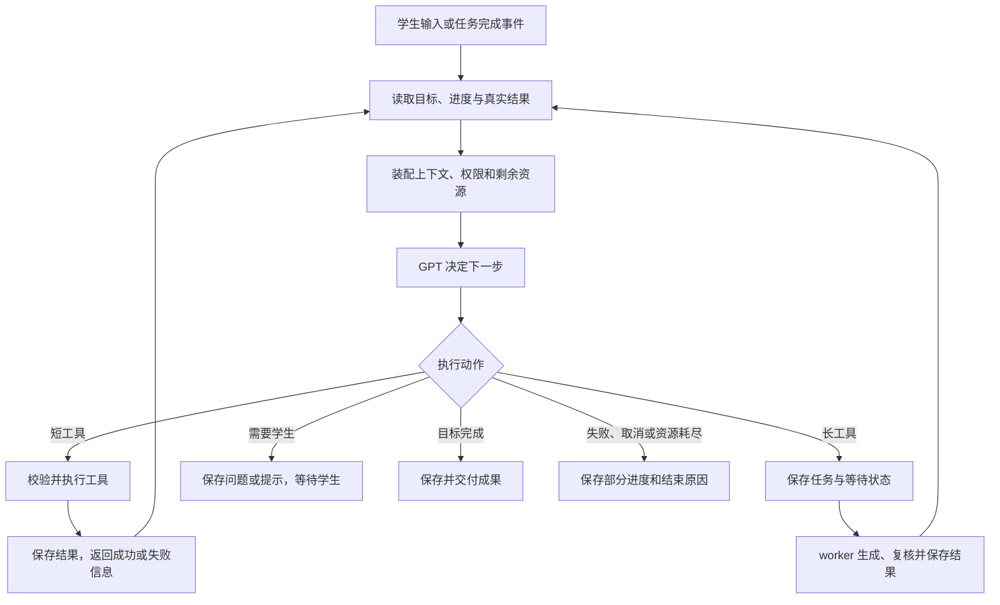

# Luma Agent 设计

依据：[系统设计](architecture.md)、[PRD](../spec/PRD.md) FR-03～FR-06、FR-11。整理日期：2026-11-05。

**职责：定义 Agent 内部执行机制：单层循环、工具协议、任务等待、上下文、记忆、提示词、预算与失败恢复。** 本文保留原设计的运行时接口及伪代码；这些是设计约束，不是当前接入状态声明。实际验证见 [验证记录](../delivery/verification.md)。

## 1 Agent 编排与执行循环

### 竞赛版实施边界

本章按以下范围实施。后文的内部接口及伪代码用于说明执行关系，不要求建设通用 Agent 平台。

| 首期必做 | 实现深度 |
| --- | --- |
| 单 Agent 执行循环 | 原生工具调用、结果回传、继续决策、明确停止；只维护一层循环 |
| 模型适配与工具执行 | GPT 调用、流式响应、参数及权限校验、真实执行与结果结构校验 |
| 上下文与基础记忆 | 数据库保存题干、目标、消息、材料及作答；保留关键事实，限量加载近期消息 |
| 防循环与异常 | 分项次数上限、超时、取消、有限重试、重复失败和无进展检测 |
| 去重与保存 | 重复请求不重复创建成果；旧版本和取消后的迟到结果不覆盖当前数据 |
| 后台任务 | 保存状态、输入及结果，页面重回可查询；组合目标只保存必要等待点并恢复 |
| 基础观测与评测 | 请求和工具日志、耗时及用量、失败原因、真实数学样例与真机验证 |

首期不做：自建模型推理服务或 KV cache、自动摘要压缩、教材 RAG、长期画像、多 Agent、任意代码位置精确续跑、通用工作流引擎、分布式调度平台、精细费用预留及结算系统。GPT 托管调用的推理缓存由提供商处理；应用不依赖缓存命中保证正确性。

部署先使用一个服务实例和一个 worker，保留数据库条件更新、请求唯一约束与已有任务租约即可。组合目标采用最小等待点恢复，不扩展为可编排任意流程的引擎。若执行片段意外中断，明确失败并支持有限重试，保留已完成内容；不承诺从任意中断位置自动续跑。

### 1.1 编排目标与职责

Luma 的核心是教学 Agent：理解学生当前想解决的问题，结合学习记录决定下一步，选择工具执行，观察结果后继续决策，直到完成请求或需要学生参与。主架构采用 **单教学 Agent + 工具执行器 + 持久化任务状态**；耗时的图文和练习生成交给 worker。

GPT 负责教学策略、语义判断、工具选择及结果解释。程序负责提供真实状态、执行允许的工具、限制资源、保存结果。讲义生成等工具内部可以使用明确的步骤，它们作为 Agent 的能力被调用，不代替上层 Agent 的目标判断。

| Agent 决定 | 程序保证 |
| --- | --- |
| 学生缺少的是概念、思路还是某一步的解释 | 本次引用的题目、段落、练习和账号正确 |
| 是否需要识别、查阅已有材料、生成讲义或练习 | 工具可用范围、参数、权限与版本校验 |
| 追问、换例子、补充图解或推进练习 | 工具执行、持久化、真实状态反馈 |
| 根据成功或失败结果调整下一步 | 超时、取消、幂等、预算和结果发布条件 |
| 已完成目标还是需要等待学生 | 不把任务登记成功伪装成教学内容已经生成 |

首期使用现有 Vercel AI SDK 与 TypeScript 实现一个运行时，不额外增加多 Agent、独立规划模型或另一套编排框架。架构是否成立，以新问题和多轮场景能否真实执行验收，不以框架名称判断。

### 1.2 区分会话、运行、决策与调用

| 概念 | 定义 |
| --- | --- |
| 会话 `Conversation` | 一次持续学习的容器，可包含多个题目或知识点对象以及多次学生输入 |
| 用户轮次 `Turn` | 一次学生输入或明确操作；可能触发一次简短答疑，也可能触发多个教学动作 |
| 任务运行 `AgentRun` | 处理本次请求的逻辑运行；可跨越前台请求和后台任务等待 |
| 决策步骤 `DecisionStep` | 主 Agent 读取当前状态，调用 GPT 决定回复、调用工具或等待 |
| 工具往返 `ToolRound` | Agent 发出一批工具调用，程序执行并返回结果；下一次决策可能继续调用工具或结束 |
| 工具执行 `ToolExecution` | 一个具体工具的一次执行；同一批可有多个，首期顺序执行 |
| 模型请求 `ModelRequest` | 对模型服务的一次实际请求，包括主 Agent、识别、正文、配图、复核和重试 |

工具往返轮数不等于模型请求数。普通提示可能只有一次模型请求；图文教学加练习可能有多次主 Agent 决策及多次工具内部调用，不能统一限制为“四次模型调用”。一次决策也不必机械对应一个工具执行。

### 1.3 任务状态与最小计划

每次运行保存一个结构化任务记录 `TaskFrame`，至少包括：学生目标、当前对象及版本、本次请求的成果、已完成成果、待确认信息、当前工具与任务引用、运行状态。它记录可核验的工作进展，不保存模型内部推理，不推断学生长期掌握率。

例如“用图讲清对称轴，再给两道题”：目标包含讲义和题组两项。讲义登记成功只表示其中一项开始执行，不能丢掉“再给两道题”。下一步由 Agent 根据实际结果选择，无需预先生成不可更改的完整行动清单。

Agent 仅自动推进学生本次已请求的目标，不因已有某项工具就自行扩充任务。学生只要方向提示时不顺带生成整份讲义和题组；学生表达不清时先澄清。执行动作变化可以动态决定，原始用户目标与来源仍保留，避免把模型临时提议误记为学生要求。

运行状态：

- `running`：正在决策或执行短工具。
- `waiting_job`：等待已登记的材料任务，释放前台连接，不保持模型空转。
- `waiting_user`：需要核对题干、澄清对象或等待学生思考；本次运行停止自动执行，学生下一次输入开启新运行。
- `completed`：本次请求的目标已完成，可交付结果。
- `failed`、`cancelled`：执行失败或被取消，保留已完成记录及原因。

教学阶段与上述运行状态独立：`guiding` 表示正在引导，不表示模型仍在运行；`explaining` 不表示所有练习答案都可展示。

### 1.4 核心循环



1. 接收输入并验证身份、归属、来源版本和请求标识，恢复当前目标与学习状态。
2. 装配当前对象、近期消息、相关材料、任务结果和本轮允许的能力。学生明确操作作为高置信度意图，仍校验前置条件。
3. 调用 GPT，选择面向学生的回复或符合 schema 的工具调用。不要求模型输出内部推理。
4. 工具执行器检查参数、权限、版本、取消与预算，执行真实能力并记录结果。
5. 将工具的成功、可恢复错误或质量问题返回 Agent，更新任务记录；Agent 决定继续、换策略、澄清或结束。
6. 短工具结果在本次执行中继续循环；长工具进入 `waiting_job`，在任务结果就绪后恢复决策。
7. 需要学生思考、确认或补充时进入 `waiting_user`，停止自动调用，不能自行代答后继续教学。
8. 完成目标或遇到失败、取消及资源上限时停止，保存消息、成果引用、状态和消耗。

明确的单步按钮可直接调用已知工具执行器，减少一次没有价值的模型路由；它与自由输入共用权限、状态和执行记录。涉及多个目标或条件不充分时仍进入 Agent 决策，不用按钮对应的固定流程替代整轮任务。

### 1.5 后台等待与恢复决策

图文生成耗时不能决定 Agent 的目标是否结束。登记长任务后保存 `pendingToolCall`、任务引用、任务记录和恢复所需的消息/工具协议片段，返回真实生成状态；关闭当前流式连接。`waiting_job` 不是 `completed`。

worker 完成材料生成后保存结果。运行调度器检查待恢复运行，通过数据库条件更新领取一次恢复执行权，加载真实结果，再进入同一个 Agent 循环。成功结果用于决定下一步，失败结果用于判断是否有限修复、提供已有内容或请学生重试。

首期复用数据库和现有 worker，按待完成任务记录检查恢复条件，不引入通用工作流引擎。仅保存明确等待点所需状态，进程中途崩溃标记中断，不保证任意代码位置的精确续跑。

后台运行中的新回复和任务进度通过会话/任务查询展示，不要求旧 SSE 连接一直在线。读取状态不触发新的模型调用。

同一会话只允许一个执行者推进对话。学生在等待时发来新要求，应在会话短事务内暂停原运行的自动续接，并以新输入重新决策；已授权的旧材料任务可继续保存成果，但不能擅自推进新的教学动作或覆盖当前焦点。改题干时按版本规则使旧任务失效，显式取消时停止相应运行及未完成任务。

### 1.6 教学权限与灵活性

服务端构造 `TurnPolicy`：来源版本、焦点、允许工具、允许回复类型、当前题解析权限和剩余资源。模型不能自行授予权限。

| 场景 | Agent 的选择空间 | 程序约束 |
| --- | --- | --- |
| 原题尚未确认 | 识别、查阅原图、指出疑问和澄清 | 不以未核实条件解题或生成原题讲义 |
| 已确认题目 | 追问、提示、讲解、读取已有材料或生成练习 | 保持来源与小问一致，默认启发引导 |
| 清楚的知识点请求 | 直接讲解、换例子或出题 | 不强制经过拍题流程，不虚构学生已提供的材料 |
| 练习中追问 | 理解草稿、定位困难、提供提示 | 默认上下文不加载参考答案；请求解析仅授权当前题 |
| 局部讲解 | 读取对应段落，先解释或按需换例子 | 修订创建新版本，不覆盖原讲义 |
| 工具失败 | 调整允许的参数、解释原因或请求补充 | 不伪造成功、不无限重复、不绕过权限 |

明确的“查看解析”操作在检查对象后建立本次权限。自由输入主动索要解析时可识别为同等意图；无法确定时澄清或提供查看入口，不以模型声称已获授权为依据。新题、新小问或新练习不继承原授权。

模型能够自行推导答案，因此工具与数据权限不能保证引导文字绝不泄露结论。教学语义通过提示词、输出要求及样例评测控制；系统权限、已知答案的数据投影和工具执行由程序强制约束。

草稿、自评、收藏、归档和账号操作继续使用普通接口，它们为 Agent 提供可靠状态，不必为了“全部 Agent 化”增加模型调用。

### 1.7 资源控制与停止条件

分别配置和记录以下资源，不混用计数：

| 维度 | 作用 |
| --- | --- |
| 决策步骤上限 | 限制主 Agent 连续决策，SDK 多步骤上限仅映射到此维度，需核对 SDK 的计数定义 |
| 工具往返及实际执行上限 | 防止工具循环；一次步骤内多项调用分别记录 |
| 各类模型请求及重试数 | 统计主 Agent、识别、生成、复核、图片与失败重试 |
| 输入输出 token 与图片数量 | 配置请求与任务用量上限，记录实际用量；首期不建设费用预留和结算系统 |
| 单次调用、执行片段及任务总时限 | 防止网络等待或后台任务永久占用 |
| 无进展与重复失败 | 相同工具、相同参数、相同失败重复出现时停止自动尝试 |

不设整轮统一模型调用次数上限。各分项保护阈值在简单问答、图文生成、组合任务和失败修复样例跑通后确定；接入时必须提供可配置的保护上限，不能无限运行，也不能把试验参数写成产品工作周期。后台等待和恢复不得重置整项任务累计预算。

正常停止条件是：目标已完成、需要学生参与、等待后台结果。异常停止条件是：取消、版本失效、不可恢复错误、持续无进展或资源耗尽。简单问题不为了凑循环而调用工具；复杂请求也不为固定次数提前假装完成。

### 1.8 一条完整执行轨迹

已明确知识范围后，学生说：“用图讲清二次函数对称轴，再给我两道同类题。”一种可能的执行为：

| 顺序 | 执行内容 | 决策与计数 |
| --- | --- | --- |
| 1 | 主 Agent 判断需要图文讲义，调用 `createLesson` | 主 Agent 决策 1 次；工具执行 1 次 |
| 2 | 后台生成正文、生成配图、视觉复核，保存真实讲义 | 模型请求 3 次，其中图片请求 1 次；期间运行等待 |
| 3 | 恢复 Agent，读取讲义结果，确认仍需两道题，调用 `createPractice` | 主 Agent 决策再 1 次；工具执行再 1 次 |
| 4 | 后台出题、复算复核，保存题组 | 模型请求再 2 次 |
| 5 | 恢复 Agent，确认本次目标完成，返回讲义与练习入口 | 主 Agent 决策再 1 次，运行完成 |

在不重试、不修复的假设下，这条轨迹有 3 次主 Agent 决策、2 次工具往返、2 次工具执行、8 次模型服务请求。它是说明计数的示例，不是每个问题必须遵循的模板。学生只问一个提示时可能一次回复就结束；中途要学生确认题干时必须先等待。

### 1.9 持久化与代码职责

同请求幂等依赖数据库唯一约束和短事务，不只使用进程内 Map。工具、模型调用期间不持有数据库事务；状态更新、恢复执行权和最终发布通过条件更新防止迟到结果覆盖取消或新版本。外部调用与数据库不能形成一个原子事务，极端故障可能产生费用而未保存结果，应标记中断并有限重试。

| 模块（相对 `luma/apps/server/src`） | 目标职责 |
| --- | --- |
| `agent/loop.ts` | 组织读取、决策、工具执行、观察及停止 |
| `agent/policy.ts` | 根据真实状态计算工具与答案权限 |
| `agent/context.ts` | 装配当前目标、材料、近期对话及工具结果 |
| `lib/model.ts` | 统一 GPT 调用、超时、输出适配及消耗记录，复用现有调用封装 |
| `agent/tools.ts`、`agent/tool-executor.ts` | 工具定义、参数与权限校验、执行和错误归一化 |
| `agent/limits.ts` | 分别管理步骤、请求、执行、时间和用量预算 |
| `services/run.service.ts` | 运行领取、任务记录、消息落库、等待、恢复、取消和幂等 |
| `jobs/`、`worker/` | 执行长工具、生成复核、记录结果及调度恢复 |
| `agent/prompts/`、`packages/shared`（仓库根目录） | 版本化指令、输入输出及事件契约 |

真实接入先验证“读取当前对象 → 调用工具 → 根据真实结果继续回复”，再验证长工具等待与组合目标。代码状态及待办见实施进度与实施计划。

### 1.10 运行时实现：只保留一个循环所有者

选择由项目运行时管理循环，AI SDK 每次仅调用一个模型步骤。业务工具通过原生 function/tool calling 暴露；不靠模型在普通回复中输出“我要调用某工具”，也不从自然语言或 Markdown 中正则提取工具名。

SDK 的职责是协议转换、流式响应解析、模型请求及用量返回。项目运行时的职责是循环、状态、执行工具、持久化和恢复。SDK 工具描述只传名称、说明和参数 schema，不注册自动执行 `execute`，不同时开启 SDK 多步骤自动循环。底层自动重试关闭，由统一调用层管理并计数。

目标适配形态如下，具体事件字段以实际安装的 SDK 类型为准：

```ts
// model.next 的内部调用形态；此处为设计示意，不是已接入代码。
streamText({
  model,
  messages,
  tools: nativeToolDefinitions, // 定义 schema，不配置 execute
  stopWhen: stepCountIs(1),    // 只允许 SDK 生成一个步骤
  maxRetries: 0,              // 避免 SDK 隐式重试绕过统一计数
  abortSignal,
});
```

一次步骤可能返回工具调用、结束文本或错误；适配层归一化为内部结果。业务调用参数只在完整接收并通过 schema 校验后执行，不能拿半条工具参数启动任务。模型返回格式不合约时，给出明确校正信息，在剩余预算内允许一次修正；截断、拒绝和网络失败分别记录，不把它们当作正常完成。

### 1.11 内部对象与结束协议

运行快照、模型消息、工具执行记录分开保存，便于恢复，避免只保存聊天文本而丢失协议信息。

```ts
// 内部接口示意，完整字段、关系与约束在迁移时落实。
type RunSnapshot = {
  runId: string;
  conversationId: string;
  userId: string;
  subjectRevisionId: string | null;
  status: 'running' | 'waiting_job' | 'waiting_user'
    | 'completed' | 'failed' | 'cancelled';
  version: number;                 // 状态乐观并发版本
  task: TaskFrame;                 // 原始目标、待办与已验证的成果引用
  protocol: ModelMessage[];        // 当前运行的必要协议消息，含工具调用
  pendingBatch: PendingToolBatch | null;
  counters: RunCounters;           // 各计数分别记录
  deadlineAt: string;
};

type ToolOutcome =
  | { kind: 'result'; value: unknown }
  | { kind: 'error'; code: string; retryable: boolean; message: string }
  | { kind: 'deferred'; jobId: string };
```

`ModelMessage` 使用 SDK 支持的消息类型；不能把工具结果降为普通 assistant 文字。`TaskFrame` 是业务目标记录，不是模型思维链。它的目标更新由模型提出并经 schema 和范围校验，已完成成果只能由真实工具记录证明。不能只凭模型输出“完成了”就补一个成果 ID。

为准确区分“等待学生”和“本次完成”，提供内部控制工具 `respond`，参数为 `disposition: wait_user | finish`、`text` 和可选成果引用。它不访问外部服务，是经过校验的终止协议，不计作业务工具执行；产生它的模型请求仍计入决策次数和用量。`finish` 必须满足任务所需成果已存在、可访问且没有未完成的必需项。

`respond` 与业务工具在同一步混用时不执行终止，返回协议校正信息；不先发“已完成”再继续生成。普通无工具最终文本作为协议不合约处理，不凭猜测设置运行状态。若 GPT 请求被拒绝，适配层返回独立拒绝/失败结果并可展示说明，不能反复强制其继续生成。

学生可见正文从 `respond.text` 输出：流式时仅增量解析该字段，禁止把原始工具 JSON 或其他字段转发到前端。结构化结果完整后才可提交终态和正式卡片。不能可靠提取增量字段时采用整段校验后显示的降级方式，并记录流式功能尚未验收；不能在文档中把降级冒充已实现。引导模式不向模型加载参考答案，但仍需教学样例发现其自行推导提前泄露的情况。

### 1.12 驱动器与工具执行器

以下伪代码说明控制关系，不与当前源代码逐行对应；SDK 不自动承担这些持久化和调度职责。

```ts
async function drive(runId: string) {
  // 原子领取会话执行权和运行租约；未领取到则退出。
  const lease = await runtime.claim(runId);
  if (!lease) return;

  try {
    for (;;) {
      const state = await runtime.loadOwned(lease);
      await runtime.assertActive(state, lease); // 取消、版本、时限、预算

      // 恢复点：先完成已有工具批次，不能重发模型请求跳过旧结果。
      if (state.pendingBatch) {
        const outcome = await tools.advanceBatch(state, lease);
        if (outcome.kind === 'waiting') {
          await runtime.park(lease, outcome.jobIds);
          return; // 不保持 Node 调用栈或模型连接
        }
        // 保存每个 toolCallId 对应的结果，完成批次后才再次问模型。
        await runtime.commitToolResults(lease, outcome.results);
        continue;
      }

      const policy = await policies.build(state);
      const input = await context.build(state, policy);
      await budgets.spendDecision(lease, input); // 检查并扣次数，配置输出上限
      const step = await model.next(input, policy, lease.abortSignal);
      await budgets.recordUsage(lease, step.usage); // 记录用量，不实现费用结算
      await runtime.assertActiveLatest(lease); // 调用期间可能已被取消

      if (step.kind === 'respond') {
        const reply = await outputs.validate(step, state, policy);
        await runtime.commitReplyAndStatus(lease, reply);
        return;
      }

      if (step.kind === 'tool_calls') {
        // 先保存 assistant 工具调用消息，再产生业务副作用。
        await runtime.commitPendingBatch(lease, step);
        continue;
      }

      // 有限校正、失败或拒绝；不可恢复时保存终态并结束。
      if (!await runtime.handleModelIssue(lease, step)) return;
    }
  } catch (error) {
    await runtime.failIfStillOwned(lease, error);
  } finally {
    await runtime.releaseIfOwned(lease);
  }
}
```

工具执行器的内部顺序：按工具名查注册表 → 重新验证当前权限 → 完整参数 schema → 校验引用归属和版本 → 计算执行幂等键 → 领取执行记录 → 扣减资源 → 调用 TypeScript handler → 校验结果并保存 → 返回结构化结果。

- 已完成的同一工具调用读取原结果，不再产生副作用；幂等键至少包含 `runId + decisionId + toolCallId`，另对真实业务操作设唯一约束。
- `toolCallId` 是协议关联，不足以代替业务去重。模型换一个调用 ID 重复创建同一目标成果时，应复用已进行中的同一操作；明确的重新生成是新操作，不能只用“题目版本”永久去重。
- `readLearningContext` 返回受权限约束的实际数据；`recognizeMaterial` 内部调用视觉模型；`createLesson` 和 `createPractice` 原子创建 `ToolExecution` 对应任务及输入快照，返回 `deferred`。
- 模型在一个步骤提出多个工具调用时，保存整个批次，首期顺序执行。遇到长工具先保存剩余待执行项；恢复后完成所有调用，并为每个 ID 补齐结果，才允许下一次模型决策。不能只保留第一个调用或丢弃其他 ID。
- 校验失败作为该工具调用的 error 结果返回模型；进程崩溃则标记执行中断。模型能观察错误，但无权修改权限字段或执行任意函数。

### 1.13 后台恢复与消息协议

原生工具消息的对应关系必须保留：

```text
user: 讲清这个知识点并给两道题
assistant: tool_call(id=call_A, name=createLesson, arguments=...)
[保存调用和等待状态；worker 生成材料]
tool: tool_result(toolCallId=call_A, value={artifactId, status: published})
assistant: tool_call(id=call_B, name=createPractice, arguments=...)
[再次等待并恢复]
tool: tool_result(toolCallId=call_B, value={artifactId, status: published})
assistant: tool_call(id=call_C, name=respond,
                     arguments={disposition: finish, text: ...})
[验证并保存最终用户消息；终止调用不再发回模型]
```

任务登记为 queued 只是执行器的中间状态，不作为 `call_A` 的最终生成结果。运行时暂停该调用，worker 终态保存后才补入 published 或明确 error 的工具结果。否则模型会把“已排队”误当作“已获得讲义”，或只留下一个无法继续的任务引用。

具体恢复步骤：worker 在短事务内保存材料与任务终态 → 调度器扫描 `waiting_job` 及关联任务终态 → 通过状态版本和租约条件领取执行权 → 按 `toolCallId` 合并结果并调用同一 `drive`。扫描可以重复，推进必须去重；等待入库前任务已完成也应能被下一次扫描发现。

首期使用数据库状态条件和版本检查防止重复推进，复用已有材料任务租约；单服务实例、单 worker 下不另建分布式 fencing 协议。取消、改题干或新输入暂停旧运行后，旧执行者无权提交当前进度；无法取消的外部请求允许返回，但不能覆盖新状态。超期执行片段标记中断并支持显式重试；只对已保存的必要等待点恢复，不建设通用运行快照平台。

当前运行使用的最小工具协议快照需保留至运行结束；跨运行只恢复业务状态、学生可读消息及成果引用，不把未配对工具消息放入新运行。快照保存私有数据库，诊断日志仅记录引用和摘要。图片在快照中保存附件标识，恢复时重新签发可用访问地址，避免旧临时 URL 过期。

### 1.14 上下文、记忆与运行观测的代码实现

上下文装配不是把所有历史拼到 system 字符串。由 `context.build` 从明确来源形成分层消息：可信规则和程序权限 → 当前用户输入 → 已保存的学习状态与相关材料 → 近期完整对话 → 当前运行未丢失的工具调用与结果。题干、上传转写及材料均是数据，不能成为高优先级规则。具体消息顺序由协议适配器保持调用与结果合法配对。

每次模型决策前重新计算预算：完整保留当前题干/范围、焦点和本次目标；近期对话按完整片段从旧到新排列，优先移除最旧片段；材料仅加载指定段落，工具结果返回摘要和引用。上下文不够时先裁剪非关键材料，仍不够则明确请求缩小范围，不能截掉关键条件后继续推导。首期不实现自动摘要压缩或向量库，运行目标和成果引用仍需持久保存。

记忆由 PostgreSQL 的消息、学习对象版本、`TaskFrame`、材料及练习记录提供，按明确引用加载；进程变量只是当前执行缓存。学生自评和个人笔记按原始来源保存，不自动推断为长期能力画像。

统一模型调用层记录 `runId`、步骤、用途、尝试号、实际模型、提示词版本、用量、耗时与错误；`ToolExecution` 记录调用 ID、工具名、执行状态、结果引用及耗时。主 Agent 和工具内部 GPT 调用都经过该层，避免隐藏消耗。图片调用单独统计；流中途失败用量可能未知，保留 unknown，不记成零费用。

本节完成后才能称为运行时已接入，最小验证包括：多轮原生工具调用、带失败结果继续决策、长任务关闭连接后恢复、重复恢复不重复生成、取消后拒绝迟到写入、同一步多个工具结果配对、预算跨恢复累计，以及界面不显示原始工具参数。真实模型测试与确定性状态测试分别保留结果。

## 2 提示词与输出

### 2.1 指令结构

| 层级 | 内容 |
| --- | --- |
| 公共规则 | 高中数学教学角色、贴合已确认条件、逐步引导、说明不确定之处 |
| 当前任务规则 | 题目核对、方向提示、过程确认、讲义、出题、复核各自的目标与输出 |
| 当前状态 | 学习对象、阶段、当前练习或讲义段落、是否主动请求解析 |
| 用户及材料 | 学生消息、上传转写、讲义片段及工具返回结果 |

用户上传内容和历史材料作为待理解的数据，不得覆盖教学与工具规则。提示词在代码仓库中独立维护，运行记录保存所用版本。

### 2.2 输出类型

| 类型 | 主要内容 | 呈现位置 |
| --- | --- | --- |
| `clarification` | 待核对题干、标签、疑问点或范围问题 | 核对卡或对话 |
| `guidance` | 一个引导问题或提示、可选下一步操作 | 对话 |
| `solution` | 条件检查、推导步骤与结论 | 主动查看的解析区域 |
| `artifact_reference` | 材料或任务标识及真实状态 | 成果入口 |
| `failure` | 可理解的原因及可执行重试方式 | 消息或材料占位 |

用 Zod 校验结构。文字使用 Markdown，公式使用 LaTeX，图片通过已校验的附件标识展示。模型不返回可直接执行的 HTML、脚本和任意外部资源地址。

流式输出只展示允许的学生可见文本。结构化成果在校验后返回引用；未通过校验的草稿不成为正式材料。停止生成的消息标记为未完成，供学生区分。

### 2.3 提示词与输出的实现边界

提示词文件保留版本管理，每轮仅加载公共规则及当前任务规则；确认状态、答案权限、当前对象和剩余预算从程序状态生成，不在模板里写成固定事实。学生原话、历史消息和工具返回放在相应的数据消息中，不拼进高优先级规则。

普通教学回复使用受 Zod 约束的回复结构，至少包含 `kind`、`text`、`focusRef` 和可选操作建议；`kind` 必须符合本轮权限。题干、讲义、题组及复核结论使用各自 schema。结构校验只能保证字段和类型，不能保证数学正确。

AI SDK 接入时验证当前版本的工具调用、结构化终答和增量解析能否共同工作。只转发已确定为学生回复的文本字段，其他 JSON、工具参数、答案字段和内部过程不进入 `text.delta`；无法可靠增量解析时先完整校验，再展示该卡片。核对卡、任务引用和正式成果一律在完整校验后展示。流式文字是未完成回复，不代表已通过整段教学质量复核。

不为每条普通回复增加一次模型复核，以控制成本和首段延迟；讲义和练习发布前必须复核。对提前泄露、条件混用等教学问题持续运行样例评测，不依赖关键词过滤声称已解决。

## 3 工具设计

工具均在服务端执行；账号标识从登录态获取，当前题目等来源引用由服务端核验。

| 工具 | 输入 | 输出 | 执行方式 |
| --- | --- | --- | --- |
| `readLearningContext` | 当前会话内的题目、材料或练习引用 | 所需片段与状态 | 数据库读取 |
| `recognizeMaterial` | 本人图片引用、题目或过程类型 | 题干、步骤、标签、需确认内容 | GPT 识别任务 |
| `createLesson` | 学习对象版本、目标、可选材料及段落引用 | 讲义任务引用 | 后台任务 |
| `createPractice` | 学习对象版本、2 至 3 题、难度及训练目标 | 题组任务引用 | 后台任务 |

练习追问直接由主 Agent 根据加载的题干、学生作答及解析权限回应，不再嵌套一个重复答疑的模型工具。不另设重复答疑的嵌套 Agent。

讲义任务内部依次执行正文生成、配图生成和图文复核；题组任务内部执行出题、复核和一次修复。这些是受控任务步骤，首期无需全部暴露为模型可以任意组合的工具。

工具输出包含来源版本和执行结果。业务服务校验后保存材料；模型不能直接写数据库字段、执行任意代码或调用未知地址。

### 3.1 工具执行约定

所有工具统一返回成功数据或结构化错误，包含 `code`、`retryable` 及结果引用；不直接把异常堆栈交给模型。工具执行包装层负责参数 schema、权限、预算、超时、执行记录及结果裁剪。

| 工具 | 执行边界 |
| --- | --- |
| `readLearningContext` | 仅加载本轮会话及明确引用；按答案权限投影，不能扫描其他会话或绕过练习答案隔离 |
| `recognizeMaterial` | 仅识别已确认上传成功的本人图片；保存待确认结果，不自动把转写标为学生已确认 |
| `createLesson` | 保存讲解目标、来源版本、可选段落和被修订材料标识，任务参数在创建时固定 |
| `createPractice` | 默认两题；保存知识范围和难度，返回任务引用，不同步生成完整题组 |

工具登记任务的去重键由服务端根据业务操作及来源构造；同请求重试复用，学生明确重新生成使用新操作标识。相同引用读取可在本轮缓存。可恢复错误返回模型供其澄清或调整，权限失败不重复尝试；相同工具相同参数连续失败两次即结束，不形成工具死循环。

## 4 上下文与基础记忆

### 4.1 每轮装配

| 顺序 | 信息 | 处理方式 |
| --- | --- | --- |
| 1 | 公共指令、任务规则、允许工具 | 每轮加载 |
| 2 | 当前版本题干或知识范围、确认状态、小问 | 必须完整保留 |
| 3 | 当前讲义段落、练习题、作答及追问对象 | 按当前操作加载 |
| 4 | 近期消息 | 从近到远按预算加载完整消息，工具调用与结果成对保留 |
| 5 | 其他相关材料 | 只在明确引用或工具请求时读取 |

初始输入预算上限设为 12,000 tokens，并受实际模型上下文上限、工具定义及输出预留约束；近期消息最多加载最近 12 条，再按预算收缩。接入时依据实测调整。

关键事实放不下时先要求缩小材料或选择小问；近期必要讨论已超出预算时提示结束本轮长对话或新建对话，不静默截断题干。首期不实现自动摘要和向量检索。

### 4.2 保存与读取

- 对话记忆：消息、当前教学阶段、确认状态和材料引用。
- 任务记忆：当前练习题号、草稿、追问对象及生成任务状态。
- 学习记录：讲义、题组、作答轮次、自评、笔记及复习状态。
- 当前会话之外的材料，必须通过明确的收藏或历史入口读取，不自动扫描个人全部记录。
- 学生自评标明来源；不根据对话语气生成掌握结论，不建立长期学习画像。

### 4.3 一轮上下文示例

学生在练习第 2 题点击“这题提示”，加载：公共教学规则、提示任务规则、当前学习对象版本、第 2 题题干、本人当前轮次的草稿和提示使用记录、最近完整对话，以及本轮仅允许引导的权限。不加载其他题的参考答案，也不把整份错题本塞进上下文。

“刚才那一步”优先定位本次界面引用，其次使用数据库保存的当前焦点，再查近期对话；存在多个可能对象则澄清。不能只靠最新一条消息或全局“当前题”变量猜测。

数据库是会话和任务记忆的正式来源，小程序缓存辅助保存草稿。每轮内的工具调用与结果只用于当前工具循环；跨轮保存可读消息和结果引用，避免恢复时出现孤立的工具协议消息。首期需要的是准确恢复学习对象和进度，无需额外建设长期记忆服务。

## 5 图文与练习任务

### 5.1 图文讲解

1. 生成讲义结构：概念、分步示例、易错辨析，以及各段所需的图解。
2. 保存文字草稿，前端显示正文与“配图生成中”。
3. 按图解要求调用 GPT 图片生成，图片存入对象存储。
4. 将生成图片交给支持图片理解的 GPT，核对文字、条件和图中标注。
5. 复核通过后发布；不通过时修复一次，仍失败则保存已完成内容和失败状态。

首份讲义默认 1 张主要教学图，确有需要可扩至 2 张；每次生成前限制图片数量和消耗。配图失败只重试相应步骤。

“这一步没懂”首先形成针对该段的对话解释；需要修改讲义时创建新版本。换例子保留其他章节，重新生成该例及受影响配图，经复核后发布新版本。旧版本继续可追溯。

### 5.2 同类练习

1. 根据已确认知识范围生成 2 至 3 道题，包含训练目标、难度、答案和解析。
2. 另一次 GPT 调用检查条件、可解性和答案一致性，允许修复一次。
3. 通过后保存题组及题目。未通过不进入在线练习。
4. 题目侧信息与答案侧信息由不同接口投影返回；作答阶段不将隐藏答案预先下发。
5. 主动解析只返回当前题答案，并记录查看行为；提交后进入自评时返回本轮参考解析。

复核降低错误概率，教学样例人工评测仍是竞赛版验收的一部分。

### 5.3 执行状态

任务状态为 `queued → running → succeeded / failed / cancelled / superseded`。

- `superseded` 表示来源题目已改变，旧结果不再成为当前成果。
- 每个步骤保存进度和已完成结果，返回页面可通过任务引用查询。
- 分别配置单次模型请求、前台执行片段、单个材料任务及整个 Agent 目标的时限。后台等待计入总目标时限，恢复不重置；识别和图片生成使用各自超时配置。数值由真实链路测量确定，区别于 PRD 的响应目标。
- 只对明确可重试的瞬时故障重试一次；鉴权、额度不足及无效输入提示处理后再试。
- 取消尽量中止上游请求；无法中止时忽略迟到结果，不发布到当前材料，已发生调用仍可能产生费用。
- 进程重启后的未完成任务标记中断并允许重试；首期不实现精确续跑。

任务通过数据库原子更新领取，保存执行者和有效期，运行中刷新有效期，避免重复领取。过期任务标记中断，学生重试时创建关联的新任务；发布结果前同时检查任务仍有效、未取消及来源版本仍匹配。只读查询任务进度不重复触发模型。

### 5.4 后台任务编排与预算

| 流程 | 正常步骤 | 最多一次质量修复 |
| --- | --- | --- |
| 图文讲义 | GPT 生成结构化正文及配图说明 → 图片生成 → GPT 视觉复核 → 发布 | 按复核问题修正文案或重生成受影响图片 → 再复核；仍失败不发布 |
| 同类题组 | GPT 生成两道题及答案解析 → 独立 GPT 调用复算复核 → 发布 | 修复有问题的题 → 再复核；仍失败不发布 |
| 局部换例子 | 读取原讲义快照 → 生成新例子及受影响配图 → 复核 → 发布新版本 | 同图文讲义，原版本不覆盖 |

复核调用不带生成过程中的内部推理，要求独立检查条件、解法和答案；它与生成可使用同一服务端 GPT 配置，但不能据此保证完全独立或数学无误。

后台工具维护自己的调用、图片和时限预算，并归入所属 Agent 任务的累计消耗。质量修复最多一轮，修复后必须再次复核；瞬时失败最多重试一次，所有尝试都占用真实请求及资源额度。首期默认一张主要教学配图。具体模型请求上限按 §1.7 的样例测量确定，不把主 Agent 决策次数、短工具调用和后台生成请求合成一个“四次”计数。

首期 worker 每进程顺序执行一个材料任务，模型工具顺序执行；同一会话同一时刻仅一个执行者推进 Agent。材料等待不持有数据库锁；任务结果就绪后按 §1.5 领取恢复执行权。后台任务状态和 Agent 运行状态独立，材料成功不自动等于用户请求全部完成。账号排队及并发阈值由服务端配置，在真实延迟与费用验证后调整。

正文生成后保存可恢复草稿，显示“配图生成中/待复核”；它不是已发布讲义。失败后可继续对话或重试，不显示“已完成”。仅图片步骤失败时，在显式重试中新建关联任务，复用同来源版本已保存的正文并重新复核；其他进程中断从任务起点重试，首期不建设通用断点续跑引擎。

步骤检查点与最终发布分别保存，最终发布在一个短事务内核验任务租约、取消状态和来源版本，创建材料、题目并更新任务成功状态。模型调用与图片上传均在事务外；过期或已取消执行者无权发布结果。
