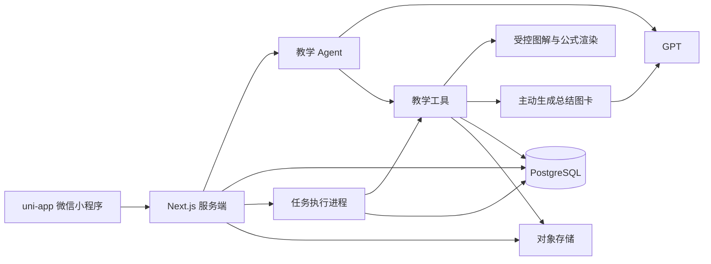

# Luma 系统设计

依据：[PRD](../spec/PRD.md)、[交互设计](interaction.md)。整理日期：2026-11-06。

**职责：定义系统边界、组件职责、业务状态和内容呈现方案。** Agent 内部执行见 [Agent 设计](agent.md)，数据库与接口见 [数据接口设计](data-api.md)，选型依据见 [技术决策](decisions.md)。本文件描述目标设计，不代表代码或真实依赖全部已完成。

## 1 系统组成

| 模块 | 负责内容 |
| --- | --- |
| uni-app 小程序 | 页面、微信登录、上传、材料阅读、练习作答、生成状态与草稿缓存 |
| 服务端 | 登录校验、账号归属、操作规则、接口与流式输出 |
| 教学 Agent | 识别任务、选择教学动作、组织回复及调用允许的工具 |
| 教学工具 | 转写、生成讲义、生成配图、出题、复核与保存结果 |
| 任务执行进程 | 执行较长的材料生成任务，写入状态和结果 |
| 数据库与对象存储 | 学习关系及记录、原图和生成图片 |

Next.js 服务与任务进程使用同一代码仓库。工具使用 TypeScript 实现，公共数据结构使用 Zod 校验。GPT 的对话与图片生成配置分别保留在服务端。

首期只验收高中数学内容，公共执行循环、学习对象、来源与工具协议保持通用。上下文由当前事实、有效教学记录、近期原文、远期过程摘要及按需回读共同提供；不是用一份摘要承载全部记忆。主Agent与材料任务使用同一相关证据包契约，后台创建时固定来源、目标和权限快照。具体机制及当前实现差距见 [Agent设计§4](agent.md#4-上下文与基础记忆)，不引入第二套记忆服务或编排框架。

内容扩展采用“共用运行时/伴学状态 + 内容配置与工具能力”边界。主对话规划选择math@1/unconfigured@1，主对话与后台材料/复核固定同版规则、表达能力和评价依据；首期只注册数学，不建设多学科路由平台。未知内容不套数学，旧数学任务缺省配置只兼容既有任务恢复。通用教学循环及职责见[教学设计§2.1](tutoring.md#21-通用伴学闭环与内容适配边界)，其他领域不因此标记可用。

## 2 教学状态

教学状态、练习状态和任务执行状态分别保存。

### 2.1 学习对象

一个会话可包含多个学习对象，类型为 `question` 或 `knowledge`；保存当前焦点对象，同一时刻只处理该对象。一次上传不拆成多段最近学习记录。

- 单题：保存题干、图片条件、知识点、小问及当前选择的小问。
- 知识点：保存主题、讲解范围及学生提供的课堂材料。
- 多道独立题分别建立对象，原图可由同一会话共享；一道题的多个小问仍属于同一对象。消息、确认状态、输入草稿、讲义、练习轮次、笔记与收藏按对象隔离，材料同时绑定对象版本。
- 切换只恢复对象及其状态，不自动确认、生成、提交或揭示答案；生成期间暂禁切换，迟到结果仍校验原对象及版本。整段对话统一重命名/归档，各对象可独立收藏。
- 题目转写待学生确认，确认仅针对原题文字、公式与条件；考点由 Agent 分析，不设考点输入或确认步骤。知识点提问允许用自己的话描述不理解的内容，不强求学生提供标准术语。
- 解题过程转写独立保存待确认步骤；学生确认或修正后，才将相应步骤作为纠错依据。多小问切换明确保存当前选择。
- 修改题干、当前小问或影响范围的标签时生成新版本，旧材料继续指向旧版本。

### 2.2 教学阶段

| 阶段 | 含义 | 允许的主要动作 |
| --- | --- | --- |
| `clarifying` | 题目待核对或知识范围待澄清 | 转写、修改、确认、澄清 |
| `guiding` | 引导学生表达和修正思路 | 方向提示、关键步骤、核对过程 |
| `explaining` | 展开完整解析或图文讲解 | 主动查看解析、生成讲义、局部追问、换例子 |
| `practicing` | 围绕同知识点练习 | 作答、题目提示、携题追问、自评 |
| `reviewing` | 回看材料与练习结果 | 复习、重做、笔记、继续对话 |

教学阶段允许按明确操作切换。已确认题目可以直接生成图文讲解；知识点直接练习也可以跳过讲义。等待学生回复时，本轮 Agent 运行结束，下一次输入启动新一轮。

### 2.3 练习状态

`intro → doing → review → summary`。

- `doing` 保存题号、文字、照片、暂不会标记和提示使用情况。
- `review` 展示参考解析，逐题填写自评。
- `summary` 保存结果，提供重做、追问、收藏和回看。
- 重做创建新轮次，可选择全部题或自评为部分会、还不会的题。
- 已完成历史轮次只读；当前自评阶段的修改更新当前轮次，不重复创建完成记录。

## 3 内容呈现与草稿

正文通过 Markdown 解析为受控富文本节点，配图使用原生图片组件。教学时由主 GPT 输出正文及结构化图示数据，服务端受控绘制并复核；学生确认理解并主动操作后，才另建静态总结图解卡任务。公式保留LaTeX源文本，服务端使用MathJax + Sharp转为PNG并缓存；排版未完成或失败时展示明确占位及单独排版重试，不把源码直接暴露给学生。渲染器禁用不可信命令与外部资源；只处理发布给当前学生的内容，作答前不输出参考答案中的公式。长公式可横向查看；正文流式增量展示，公式在本条结构完整后排版，过程中不显示半截LaTeX。分式、根式、分段函数和长不等式纳入真机显示验证。

草稿使用 uni-app Storage 按账号、练习轮次和题目保存，设置容量上限；照片优先上传，避免将图片字节塞入本地缓存。服务器记录仍为恢复依据。

## 4 跨模块约束

- 会话容纳多个学习对象；对象有独立版本、消息焦点、材料、练习与收藏。会话归档整体生效，收藏按对象生效。
- 生成任务固定对象、版本与权限快照；发布时再次验证，旧结果不覆盖新版本或后来选中的焦点。
- 学生自评、手动复习和模型教学推断分别保存，不能混成考试分数或掌握率。
- 首期使用单服务实例、单 worker 和数据库任务队列；不建设通用 Agent 平台。
- 当前实现差异及后续迁移任务统一见 [实施进度](../delivery/progress.md) 与 [实施计划](../delivery/plan.md)，不在设计正文累积施工记录。
